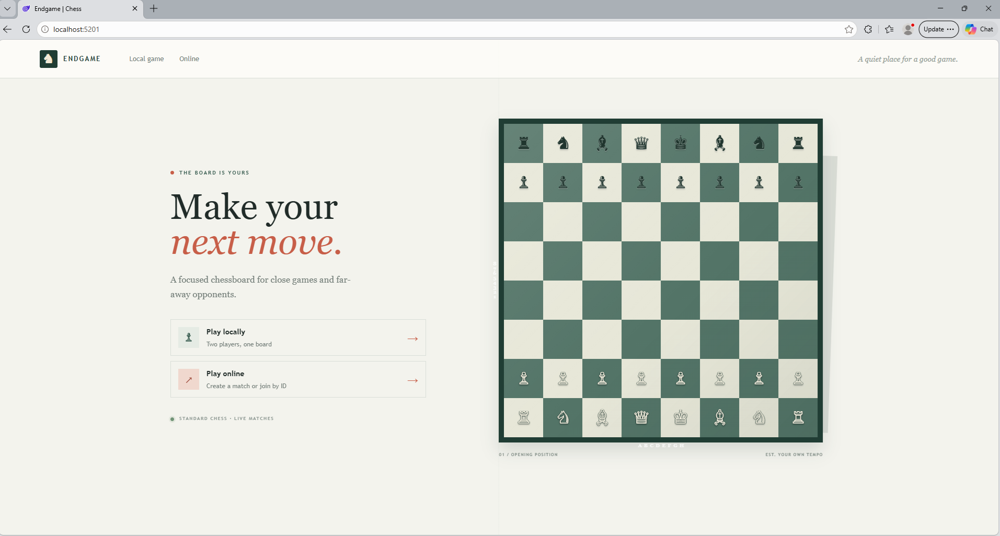
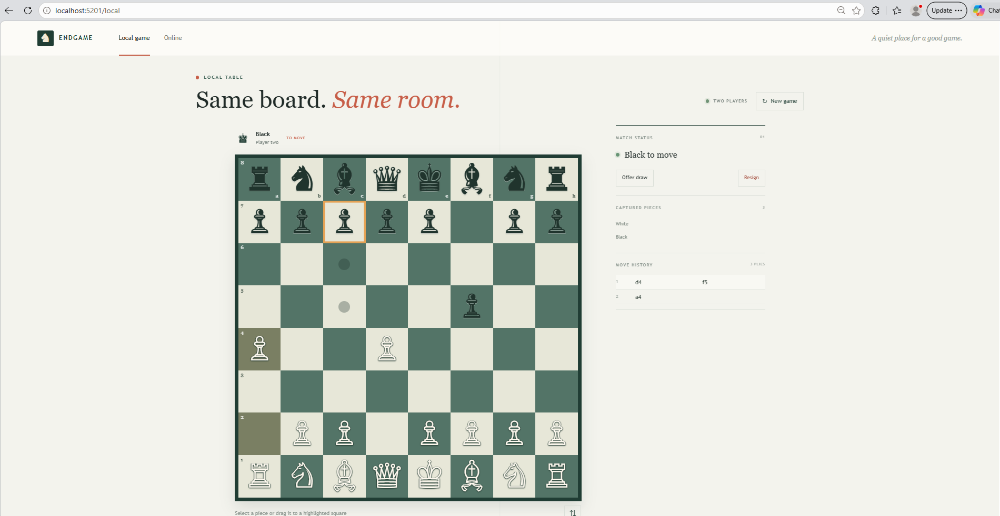
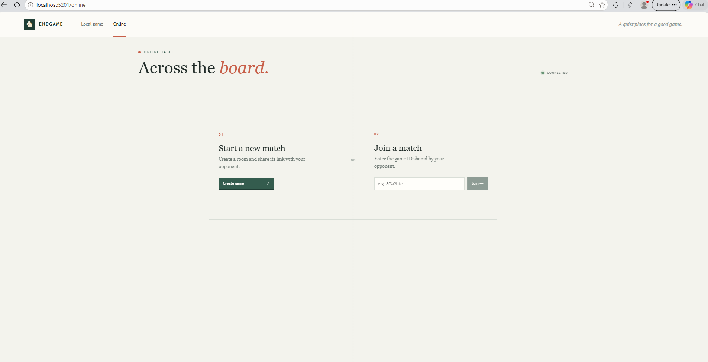
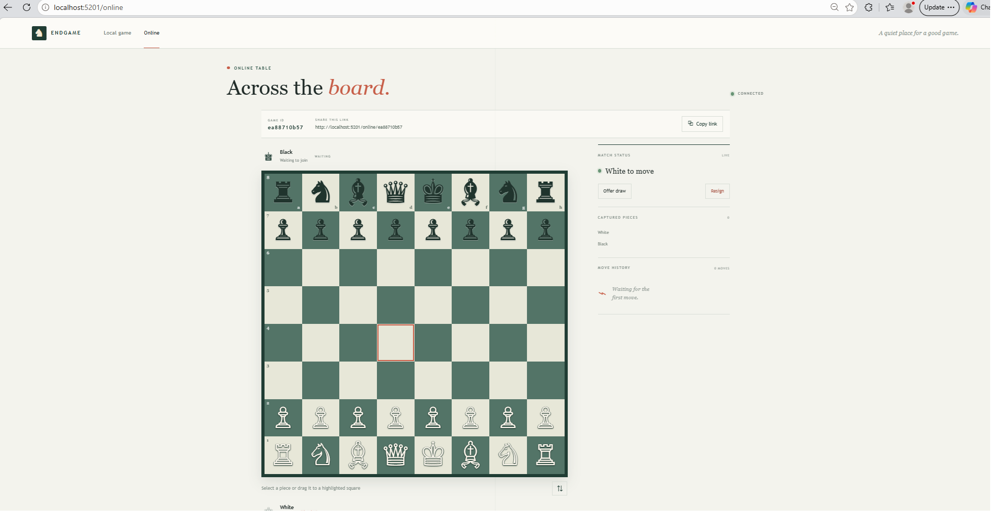
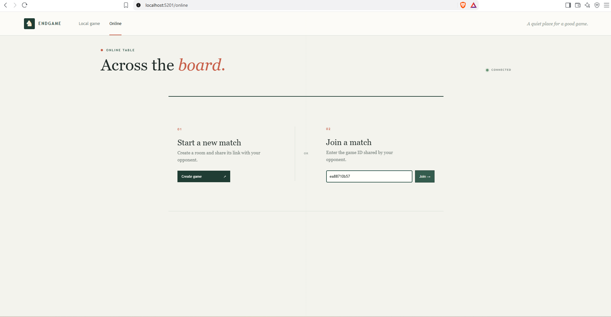

# Endgame Chess

Endgame is a .NET 10 chess app for local hot-seat games and online matches. It combines an interactive Blazor Server board with a separate C# chess domain and a SignalR hub for real-time online play.

## Features

- Play two-player chess locally at `/local` or create/join an online match at `/online`.
- Select pieces to see legal moves, or drag pieces to a destination. The board supports promotion choices and flipping for Black's perspective.
- View move history and captured pieces as the game progresses.
- Domain logic handles legal moves, castling, en passant, promotion, check, checkmate, stalemate, repetition, the fifty-move rule, insufficient material, draw offers, and resignation.
- Online games use a shareable game ID/link and SignalR updates.

## Screenshots

### Home



### Local game



### Online game







## Get Started

### Requirements

- [.NET 10 SDK](https://dotnet.microsoft.com/download/dotnet/10.0)
- A current desktop or mobile browser

### Run locally

From the repository root, restore and start the web app:

```powershell
dotnet run --project Chess.Web --urls http://localhost:5080
```

Open [http://localhost:5080](http://localhost:5080). Choose **Local game** for two players sharing one screen, or **Online** to create a match. To compile the solution:

```powershell
dotnet build Chess.slnx
```

### Play online

1. On `/online`, create a game.
2. Share the generated game link or ID with your opponent.
3. The opponent opens that link, or enters the ID at `/online`.

Both players must be able to reach the same running server. For a game over a LAN, bind the app to a host-accessible address and allow its port through the host firewall. The URL above binds to localhost and is only reachable from the same machine.

## Project Structure

| Project | Responsibility |
| --- | --- |
| `Chess.Domain` | Board state, legal move generation, rules, and game status |
| `Chess.Application` | MediatR online-game workflows and client snapshots |
| `Chess.Infrastructure` | In-memory online-match store |
| `Chess.Web` | Blazor Server UI, SignalR client, and `/gamehub` endpoint |

The domain is authoritative for move legality; UI components display its state and submit move intent. See [docs/architecture.md](docs/architecture.md) for the dependency and domain-ownership contract.

## Development Process

This project was developed using a vibe-coding workflow with GitHub MCP Copilot. The original project prompt is included in [docs/Project_Prompt.txt](docs/Project_Prompt.txt).

## Support

- For a bug or feature request, [open an issue](https://github.com/Adel-alfa/Chess/issues).
- For architectural boundaries, see [docs/architecture.md](docs/architecture.md).
- The solution currently has no automated test project or API reference document.

## Maintainers and Contributions

The repository is maintained by [Adel-alfa](https://github.com/Adel-alfa). Contributions are welcome: open an issue to discuss a substantial change, then submit a focused pull request with a clear description. Before submitting, run `dotnet build Chess.slnx` and describe any behavior you verified manually. Keep chess rules in `Chess.Domain` and follow [docs/architecture.md](docs/architecture.md).

## Runtime Notes

Online matches are held in process-local memory. Restarting the server loses active matches, and separate app instances do not share state. A game link grants access to its match; players are identified by their SignalR connection rather than an authenticated account. Production hosting needs durable shared storage, appropriate access controls, and SignalR scale-out before running multiple instances.

No license file or automated CI workflow is currently present, so this README intentionally does not claim a license or build-status badge.
